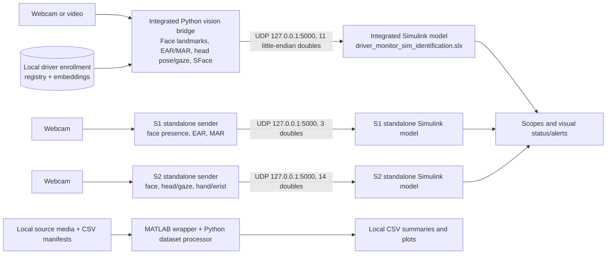

# System architecture

The project has one integrated live pipeline, two standalone section demos, and a separate offline evaluation workflow. The integrated live path combines S1, S2, and S3 features in one Python sender and one Simulink model.

Only one live sender can use UDP port 5000 at a time. Each receiving model expects a different packet size; do not connect a sender to a model from another mode. Batch evaluation uses separate local files and does not use the live camera sender.

## Integrated live path

`INTEGRATED_SYSTEM/Python_UDP_Bridge/master_driver_monitor_udp.py` extracts camera features and sends the 11-value stream to `SECTIONS/S3_Driver_Identification/driver_monitor_sim_identification.slx`. The values are face presence, EAR, MAR, yaw, pitch, roll, gaze X/Y, driver ID, confidence, and identity state. Driver embeddings and names are local-only.

## Standalone section paths

- **S1:** `SECTIONS/S1_Drowsiness/mediapipe_udp_sender.py` sends face presence, EAR, and MAR (3 values) to `SECTIONS/S1_Drowsiness/driver_monitor_sim_mediapipe.slx`.
- **S2:** `SECTIONS/S2_Distraction/mediapipe_udp_sender.py` sends a 14-value hand-aware stream to `SECTIONS/S2_Distraction/driver_monitor_sim_distraction.slx`. It requires the hand landmark model.

The standalone S1/S2 paths demonstrate individual section outputs; they are not used by the integrated model.

## Offline evaluation

`INTEGRATED_SYSTEM/MASTER_DRIVER_MONITORING_REAL.m` invokes `PROJECT/Dataset_Pipeline/dataset_processing_final_REAL_FINAL.py`, which reads local section manifests and media. See [dataset and model credits](CREDITS.md) for attribution and [results status](results/README.md) for current evaluation limitations.
