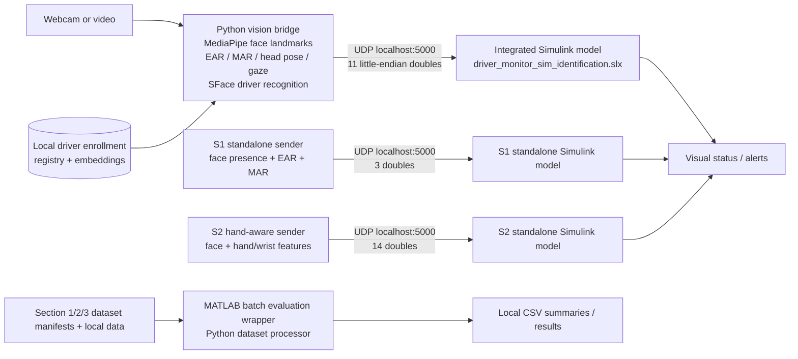

# System architecture

The repository contains one integrated live path, two standalone section paths, and a separate offline evaluation pipeline. The integrated live path is the primary system.

The standalone S1 and S2 senders use the same UDP port as the integrated sender. Run only one live sender/model path at a time. Offline evaluation is independent of the live camera bridge and requires local datasets and manifests.

## Integrated live telemetry

`INTEGRATED_SYSTEM/Python_UDP_Bridge/master_driver_monitor_udp.py` extracts camera features and sends 11 doubles to `SECTIONS/S3_Driver_Identification/driver_monitor_sim_identification.slx` on `127.0.0.1:5000`. The MATLAB model applies the integrated logic, including the S2 helper in `SECTIONS/S2_Distraction/DistractionLogicSystem.m`. Recognition requires local driver enrollment data, which is intentionally excluded from Git.

## Standalone section paths

- **S1:** `SECTIONS/S1_Drowsiness/mediapipe_udp_sender.py` sends face presence, EAR, and MAR (3 doubles) to `driver_monitor_sim_mediapipe.slx`.
- **S2:** `SECTIONS/S2_Distraction/mediapipe_udp_sender.py` sends a separate 14-double hand-aware stream to `driver_monitor_sim_distraction.slx`. It requires the hand landmark model shipped in that section.

These are separate demos with different packet formats; they are not inputs to the integrated model.

## Offline evaluation

`INTEGRATED_SYSTEM/MASTER_DRIVER_MONITORING_REAL.m` launches the dataset processor. It expects locally prepared section manifests and their referenced media under the ignored `PROJECT/Data/` tree. It does not launch the live camera system.
