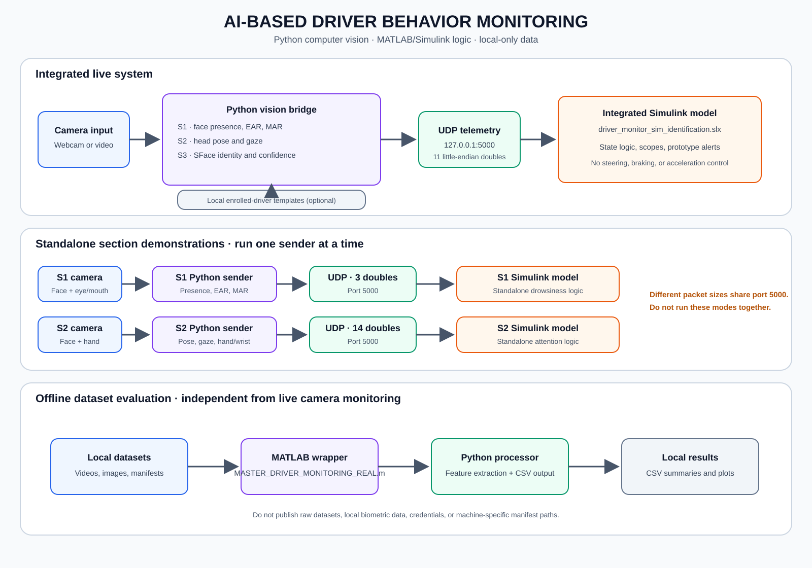
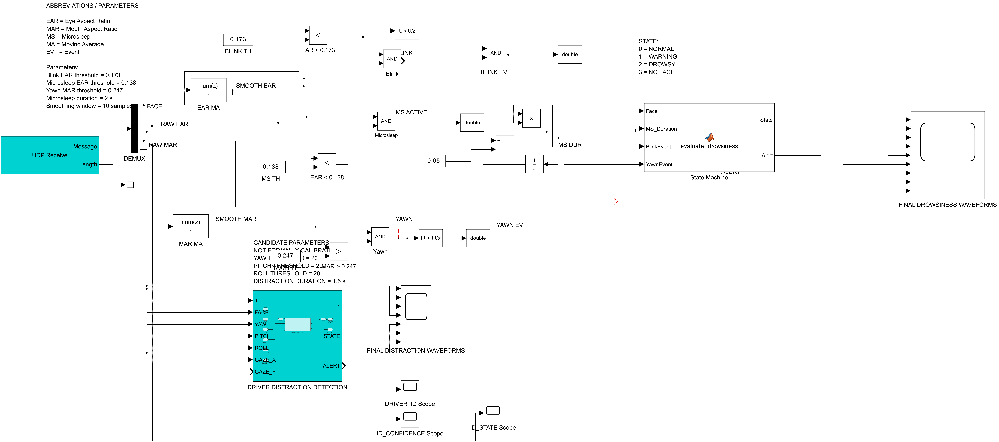
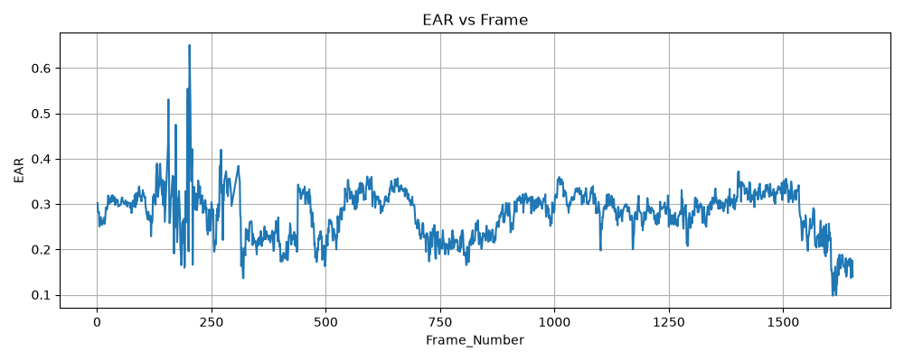
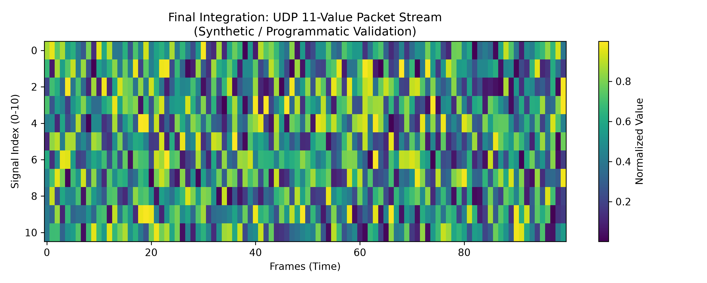

# AI-Based Driver Behavior Monitoring

A research prototype that combines Python computer vision with MATLAB/Simulink logic to monitor drowsiness, visual attention, and driver identity. The system displays status and warnings; it does not control steering, braking, or acceleration.

> **Status:** Academic prototype for driver behavior monitoring research and engineering evaluation. It combines live Python computer vision with MATLAB/Simulink outputs.

## System architecture



See [ARCHITECTURE.md](ARCHITECTURE.md) for the full explanation of each data path and packet format.

## Integrated Simulink model



This screenshot documents the included model layout; it is not evidence that the model completed a live simulation. The integrated model receives the Python bridge's 11-value UDP packet and displays prototype state/alert outputs.

## Credits

- **UTA-RLDD:** Reza Ghoddoosian, Marnim Galib, and Vassilis Athitsos, [“A Realistic Dataset and Baseline Temporal Model for Early Drowsiness Detection”](https://arxiv.org/abs/1904.07312); [official dataset page](https://sites.google.com/view/utarldd/home).
- **State Farm Distracted Driver Detection:** [Kaggle competition and dataset](https://www.kaggle.com/competitions/state-farm-distracted-driver-detection/data), subject to the competition rules.
- **CASIA-WebFace:** Dong Yi, Zhen Lei, Shengcai Liao, and Stan Z. Li, [“Learning Face Representation from Scratch”](https://arxiv.org/abs/1411.7923).
- **Runtime models:** [Google MediaPipe](https://ai.google.dev/edge/mediapipe) face/hand landmarking and the [OpenCV Zoo SFace model](https://github.com/opencv/opencv_zoo/tree/main/models/face_recognition_sface).

The project does not redistribute dataset media or driver enrollment records. Review each upstream dataset/model's terms before use. See [CREDITS.md](CREDITS.md) for access details, attribution, and privacy notes.

## What the project does

- **S1 — Drowsiness:** MediaPipe face landmarks produce eye aspect ratio (EAR) and mouth aspect ratio (MAR) cues. The model applies temporal drowsiness logic.
- **S2 — Visual attention/distraction:** The integrated bridge estimates head pose and gaze. A separate S2 demo can also send hand/wrist features. Phone detection is not implemented.
- **S3 — Driver identification:** OpenCV SFace embeddings are compared with locally enrolled driver templates; confidence and temporal filtering feed the integrated telemetry.
- **Integrated Simulink output:** A MATLAB/Simulink model receives the live feature stream and presents prototype state/alert outputs.
- **Offline evaluation:** A separate MATLAB/Python pipeline can process local datasets using manifests. It does not start the live camera system.

See the complete [system architecture](ARCHITECTURE.md), [S1 guide](SECTIONS/S1_Drowsiness/README.md), [S2 guide](SECTIONS/S2_Distraction/README.md), [S3 guide](SECTIONS/S3_Driver_Identification/README.md), and [integrated-system guide](INTEGRATED_SYSTEM/README.md).

## Data paths

The normal live path uses one Python process and one Simulink model. Standalone S1 and S2 use different UDP packet formats and must be run separately. Only one live sender should use UDP port `5000` at a time. The integrated model expects 11 doubles; the standalone S1 and S2 models expect 3 and 14 respectively.

## Repository layout

```text
.
├── README.md
├── .gitignore
├── ARCHITECTURE.md
├── architecture.svg
├── integrated-simulink-model.png
├── CREDITS.md
├── LICENSE
├── requirements.txt
├── INTEGRATED_SYSTEM/
│   ├── README.md
│   ├── MASTER_DRIVER_MONITORING_REAL.m
│   └── Python_UDP_Bridge/
│       ├── master_driver_monitor_udp.py
│       ├── live_enrollment.py
│       ├── Task3C_Enrollment.py
│       ├── Task3D_Recognition_Core.py
│       ├── Task3E_Confidence_Logic.py
│       ├── Task3F_Temporal_Filter.py
│       ├── head_pose.py
│       └── gaze_diagnostic.py
├── PROJECT/
│   ├── Dataset_Pipeline/
│   │   └── dataset_processing_final_REAL_FINAL.py
│   └── Models/
│       ├── external_backends/
│       │   └── face_landmarker.task
│       └── identification/
│           └── face_recognizer_fast.onnx
├── SECTIONS/
│   ├── S1_Drowsiness/
│   │   ├── README.md
│   │   ├── mediapipe_udp_sender.py
│   │   └── driver_monitor_sim_mediapipe.slx
│   ├── S2_Distraction/
│   │   ├── README.md
│   │   ├── mediapipe_udp_sender.py
│   │   ├── DistractionLogicSystem.m
│   │   ├── SteeringWheelDashboard.m
│   │   ├── driver_monitor_sim_distraction.slx
│   │   └── hand_landmarker.task
│   └── S3_Driver_Identification/
│       ├── README.md
│       ├── Task3C_Enrollment.py
│       ├── Task3D_Recognition_Core.py
│       ├── Task3E_Confidence_Logic.py
│       ├── Task3F_Temporal_Filter.py
│       └── driver_monitor_sim_identification.slx
└── results/
    ├── README.md
    └── figures/
        ├── s1-ear-demo.png
        ├── s1-state-demo.png
        ├── s2-yaw-demo.png
        ├── s2-state-demo.png
        └── integrated-udp-synthetic.png
```

Raw videos/images, datasets, manifests with machine-specific paths, personal driver data, generated logs, intermediate plots, and MATLAB cache files stay local and are excluded from version control.

## Requirements

- Windows or Linux with Python 3.10+ and a working webcam for live monitoring.
- MATLAB with Simulink and DSP System Toolbox for the included UDP Receive blocks. Toolbox and MATLAB release compatibility should be confirmed on the target installation.
- For the integrated path: face landmark and SFace model files listed under [Models and local data](#models-and-local-data).
- For standalone S2: the hand landmark model as well.

## Quick start: integrated live system

Run commands from the repository root. Create an environment and install the dependencies:

```powershell
py -3.11 -m venv .venv
.\.venv\Scripts\Activate.ps1
python -m pip install --upgrade pip
python -m pip install -r requirements.txt
```

If PowerShell blocks environment activation, run the virtual-environment Python directly: `.venv\Scripts\python.exe -m pip install -r requirements.txt`.

Enroll a driver before starting the integrated bridge. Give each driver a unique numeric ID and review the consent/privacy implications before collecting facial samples:

```powershell
python INTEGRATED_SYSTEM/Python_UDP_Bridge/live_enrollment.py --id 1 --name "Driver Name" --samples 20
```

Enrollment data is saved locally in `SECTIONS/S3_Driver_Identification/database/` and is ignored by Git. Do not commit enrolled face templates or names.

Start the Python process:

```powershell
python INTEGRATED_SYSTEM/Python_UDP_Bridge/master_driver_monitor_udp.py --camera 0 --fps 20
```

The bridge also accepts `--video <path>`, `--headless`, and `--skip-frames <count>`. Use `--help` for the options. It sends 11 little-endian 64-bit float values to `127.0.0.1:5000`.

In MATLAB, set the current folder to the repository root, then run:

```matlab
addpath(genpath(pwd));
open_system('SECTIONS/S3_Driver_Identification/driver_monitor_sim_identification.slx');
set_param('driver_monitor_sim_identification', 'SimulationCommand', 'start');
```

Start the Python sender before the Simulink model. The Python preview shows camera/feature status; the Simulink model shows its integrated state and warning outputs. Stop the model in MATLAB and press `q` or Escape in the Python preview to exit.

### Integrated packet fields

| Index | Signal | Description |
|---:|---|---|
| 1 | Face detected | 0/1 face-presence flag |
| 2 | Mean EAR | Eye aspect ratio |
| 3 | MAR | Mouth aspect ratio |
| 4–6 | Yaw, pitch, roll | Head pose angles |
| 7–8 | Gaze X, gaze Y | Normalized gaze features |
| 9 | Driver ID | Numeric identity code |
| 10 | ID confidence | Recognition confidence value |
| 11 | ID state | Identity state code |

## Standalone section demos

These are alternative demonstrations, not extra senders to launch with the integrated bridge.

### S1 — Drowsiness

From the repository root:

```powershell
python SECTIONS/S1_Drowsiness/mediapipe_udp_sender.py
```

Then in MATLAB:

```matlab
open_system('SECTIONS/S1_Drowsiness/driver_monitor_sim_mediapipe.slx');
set_param('driver_monitor_sim_mediapipe', 'SimulationCommand', 'start');
```

This sender transmits face presence, EAR, and MAR (3 doubles). The model uses the standalone three-input packet format. The Python overlay's eye-open/closed threshold is a candidate value, not a calibrated classifier.

### S2 — Distraction and attention

From the repository root:

```powershell
python SECTIONS/S2_Distraction/mediapipe_udp_sender.py
```

Then in MATLAB:

```matlab
open_system('SECTIONS/S2_Distraction/driver_monitor_sim_distraction.slx');
set_param('driver_monitor_sim_distraction', 'SimulationCommand', 'start');
```

This mode sends 14 doubles, including head/gaze and hand/wrist features. It requires the S2 hand model and shared face model. Do not run the S1 sender, S2 sender, or integrated sender simultaneously; all bind to UDP port 5000 and their receiving models expect different packet lengths.

## Offline dataset evaluation

The batch workflow is separate from live monitoring. It uses `INTEGRATED_SYSTEM/MASTER_DRIVER_MONITORING_REAL.m` to launch `PROJECT/Dataset_Pipeline/dataset_processing_final_REAL_FINAL.py`.

The pipeline expects local manifests at:

```text
PROJECT/Data/processed_real/manifests/section1_manifest.csv
PROJECT/Data/processed_real/manifests/section2_manifest.csv
PROJECT/Data/processed_real/manifests/section3_manifest.csv
```

The expected columns are S1: `sample_id, source_video, frame_number, source_fps, ground_truth, image_path`; S2: `sample_id, source_file, class, distraction_ground_truth, image_path, split`; S3: `sample_id, image_path, identity_ground_truth`. Media paths in the manifests must resolve on the machine running the pipeline. Dataset acquisition, use, and citation details are in [CREDITS.md](CREDITS.md). No dataset contents or personal image samples are included here.

In MATLAB, from the repository root:

```matlab
run('INTEGRATED_SYSTEM/MASTER_DRIVER_MONITORING_REAL.m');
```

The script writes local CSVs, plots, summaries, and logs under `results/` and at the root. The workflow saves local CSV summaries and plots that can be used to review each evaluation run.

## Models and local data

The live path expects these model files in the repository:

- `PROJECT/Models/external_backends/face_landmarker.task`
- `PROJECT/Models/identification/face_recognizer_fast.onnx`
- `SECTIONS/S2_Distraction/hand_landmarker.task` for standalone S2 and batch hand cues

The S1 sender and integrated sender resolve the shared face model from the repository tree. Driver enrollments, source datasets, local manifests, and raw recordings are not bundled. See [CREDITS.md](CREDITS.md) for model sources and dataset citations.

## Results and evidence

The [results guide](results/README.md) includes representative S1/S2 output graphs and an integrated telemetry visualization. The S1/S2 figures show example feature and state outputs; the integrated visualization illustrates the packet fields.

### Example traces

The S1/S2 plots are example outputs from the section demonstrations.

| S1 — EAR feature | S2 — Distraction state | Integrated — Synthetic UDP packet |
|---|---|---|
|  |  |  |

## Known limits and troubleshooting

- This prototype has not been safety-certified or validated in a moving vehicle.
- Eye, gaze, head-pose, hand-position, and identity thresholds are candidate settings that need calibration and representative validation.
- No phone-use classifier is implemented.
- Raspberry Pi/edge deployment has not been measured or verified.
- If the model shows no incoming values, confirm that only one sender is running, the sender prints that it is streaming, both processes are on the same host, and the Simulink model is listening on UDP port 5000.
- If face/feature outputs are absent, check camera framing/lighting, model-file paths, and the Python environment; confirm that the camera and required model files are available.
- If MATLAB reports missing UDP blocks, install/enable DSP System Toolbox and confirm compatibility with the MATLAB release.

## License and attribution

Project source is licensed under the MIT License in [LICENSE](LICENSE). Third-party models and datasets have separate terms; see [CREDITS.md](CREDITS.md) and the upstream terms before reuse.
