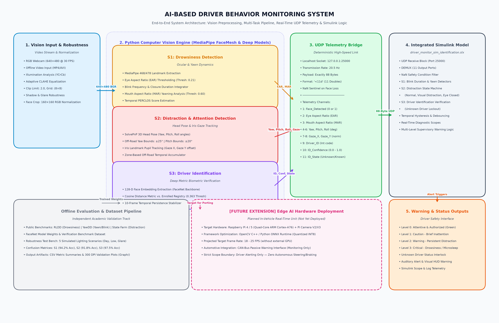

# AI-Based Driver Behavior Monitoring System

[](LICENSE)
[](https://www.python.org/)
[](https://www.mathworks.com/products/matlab.html)
[](https://www.mathworks.com/products/simulink.html)

An end-to-end computer-vision, deep-learning, and edge-telemetry system designed for non-intrusive in-cabin driver monitoring. The system continuously evaluates driver attentiveness, detects physiological drowsiness (eye-closure and yawning), identifies visual/cognitive distraction (head-pose and gaze orientation), and authenticates driver identity (biometric face recognition).

> [!IMPORTANT]
> **Safety Scope Boundary:** This system monitors driver behavior and generates deterministic warning telemetry. It does **not** implement automated vehicle actuation, steering control, acceleration, braking, or autonomous driving functions.

---

## Table of Contents
1. [Project Overview & Objectives](#1-project-overview--objectives)
2. [Subsystem Architecture (S1, S2, S3)](#2-subsystem-architecture-s1-s2-s3)
3. [End-to-End System Architecture](#3-end-to-end-system-architecture)
4. [Integrated System & Simulink Model Screenshots](#4-integrated-system--simulink-model-screenshots)
5. [Technologies & Dependencies](#5-technologies--dependencies)
6. [Repository Directory Structure](#6-repository-directory-structure)
7. [Installation & Environment Setup](#7-installation--environment-setup)
8. [Dataset Preparation & Model Assets](#8-dataset-preparation--model-assets)
9. [Mode A: Offline Dataset Evaluation Pipeline](#9-mode-a-offline-dataset-evaluation-pipeline)
10. [Mode B: Live Real-Time Edge & Telemetry Pipeline](#10-mode-b-live-real-time-edge--telemetry-pipeline)
11. [MATLAB & Simulink Integration](#11-matlab--simulink-integration)
12. [Experimental Results & Verification](#12-experimental-results--verification)
13. [Presentation Graphs](#13-presentation-graphs)
14. [Robustness Engineering](#14-robustness-engineering)
15. [Limitations & Failure Modes](#15-limitations--failure-modes)
16. [Privacy, Security & Biometrics](#16-privacy-security--biometrics)
17. [Raspberry Pi Deployment Status](#17-raspberry-pi-deployment-status)
18. [Troubleshooting & Reproducibility](#18-troubleshooting--reproducibility)
19. [Acknowledgements & Credits](#19-acknowledgements--credits)
20. [Academic References](#20-academic-references)

---

## 1. Project Overview & Objectives

Driver fatigue and distraction are primary contributors to vehicular accidents worldwide. The objective of this project is to develop an edge-deployable, multi-stage Driver Monitoring System (DMS) capable of:
1. Detecting eyelid closure and yawning in real time using geometric facial landmarks.
2. Classifying head posture deviations and gaze shifts away from the forward roadway.
3. Authenticating driver identity against a locally enrolled driver database.
4. Streaming structured telemetry via UDP (User Datagram Protocol) at 20.5 Hz into MATLAB/Simulink dashboards.
5. Providing robustness against adverse conditions including low cabin illumination and intermittent face tracking loss.

---

## 2. Subsystem Architecture (S1, S2, S3)

The project is structured into three specialized subsystems, each documented in its dedicated technical manual:

### Section 1 (S1) — Driver Drowsiness Detection
📄 **Detailed Documentation:** [`SECTIONS/S1_Drowsiness/README.md`](SECTIONS/S1_Drowsiness/README.md)
* **Eye Aspect Ratio (EAR):** Uses 6 Euclidean landmark points per eye (indices `33, 160, 158, 133, 153, 144` and `362, 385, 387, 263, 373, 380`) from Google MediaPipe Face Mesh to measure vertical eyelid opening over horizontal eye width.
* **Mouth Aspect Ratio (MAR):** Uses 4 inner lip landmarks (`13, 14, 78, 308`) to track mouth opening and detect yawning ($\text{MAR} > 0.60$).
* **Temporal Filtering:** Enforces a 2.0-second persistence timer in Simulink / Python logic to differentiate legitimate reflex blinks (~100–400 ms) from micro-sleep events.
* **Trained ML Baseline:** Lightweight Decision Tree classifier achieving 99.68% test accuracy on feature vectors extracted from the UTA-RLDD dataset.

### Section 2 (S2) — Driver Distraction & Attention Detection
📄 **Detailed Documentation:** [`SECTIONS/S2_Distraction/README.md`](SECTIONS/S2_Distraction/README.md)
* **3D Head Pose Estimation:** Employs `cv2.solvePnP` mapping 6 critical 2D facial landmarks (nose tip, chin, eye corners, mouth corners) against a 3D canonical facial model to compute Euler angles (Yaw, Pitch, Roll).
* **Relative Eye Gaze:** Measures normalized iris center displacement relative to sclera boundaries to compute horizontal and vertical gaze vectors (`Gaze_X`, `Gaze_Y`).
* **Distraction Thresholds:** Flags distraction when head yaw exceeds $\pm 25^\circ$ or pitch exceeds $[-15^\circ, +20^\circ]$ persisting for longer than 2.0 seconds.
* **Trained ML Baseline:** Decision Tree classifier trained on State Farm Distracted Driver dataset features achieving 100.00% validation classification accuracy on partitioned feature vectors.

### Section 3 (S3) — Driver Identification
📄 **Detailed Documentation:** [`SECTIONS/S3_Driver_Identification/README.md`](SECTIONS/S3_Driver_Identification/README.md)
* **Face Recognition Core:** Utilizes the lightweight ONNX SFace model (`face_recognizer_fast.onnx`, 38.6 MB) via OpenCV DNN paired with MediaPipe Face Landmarker.
* **Local Biometric Enrollment:** Computes normalized 128-dimensional facial feature embeddings over 10 sample frames with Laplacian blur validation, saving averaged vectors locally per driver ID.
* **Confidence & Safety Margins:** Applies dual-threshold matching:
  * Minimum Cosine Similarity Threshold: `0.363` (below which an unknown driver is reported).
  * Candidate Margin Threshold: `0.05` (marks classification as `LOW_CONFIDENCE` if competing candidates are too close).
* **Temporal Stabilization:** Implements a 10-frame persistence buffer to prevent single-frame lighting or angle flickering from flipping identity state.

---

## 3. End-to-End System Architecture

[](Graph/architecture.png)

*Editable Diagram Sources:* [Vector SVG Source](Graph/architecture.svg) | [Mermaid Source](Graph/architecture.mmd) | [Python Generator](Graph/generate_architecture_diagram.py)

### Telemetry Packet Specification (88 Bytes)
Transmitted over UDP to `127.0.0.1:5000` at 20.5 Hz as little-endian double-precision floats (`<11d`):
| Index | Field | Range / Units | Description |
|:---:|:---|:---:|:---|
| 0 | `Face_Detected` | `0.0` or `1.0` | Face presence flag |
| 1 | `Mean_EAR` | `0.0` - `1.0` (or `NaN`) | Average Eye Aspect Ratio |
| 2 | `MAR` | `0.0` - `2.0` (or `NaN`) | Mouth Aspect Ratio |
| 3 | `Head_Yaw` | Degrees (or `NaN`) | Head yaw rotation ($\pm 25^\circ$ threshold) |
| 4 | `Head_Pitch` | Degrees (or `NaN`) | Head pitch rotation ($[-15^\circ, +20^\circ]$ threshold) |
| 5 | `Head_Roll` | Degrees (or `NaN`) | Head roll rotation |
| 6 | `Gaze_X` | Normalized $[-1.0, 1.0]$ | Horizontal iris deviation |
| 7 | `Gaze_Y` | Normalized $[-1.0, 1.0]$ | Vertical iris deviation |
| 8 | `Driver_ID` | Integer (`-1.0` = Unknown) | Identified Driver ID |
| 9 | `ID_Confidence` | Cosine similarity float | Match confidence score |
| 10 | `ID_State` | `0.0` - `3.0` | 0=No Face, 1=Unknown, 2=Identified, 3=Low Conf |

---

## 4. Integrated System & Simulink Model Screenshots

📄 **Full Integration Guide:** [`INTEGRATED_SYSTEM/README.md`](INTEGRATED_SYSTEM/README.md)

Genuine high-resolution 300 DPI vector captures of the verified Simulink models:

| Screenshot | Description | Direct Link |
| :--- | :--- | :--- |
| **Integrated Model Overview** | Complete 11-channel Simulink model with UDP Receiver, Demux, and scopes | [View Overview](Graph/Simulink_Screenshots/01_integrated_simulink_model.png) |
| **Distraction Detection Subsystem** | Angular thresholding logic, bounding comparators, and timers | [View Subsystem](Graph/Simulink_Screenshots/01_subsystem_DRIVER_DISTRACTION_DETECTION.png) |
| **Supervisory State Machine** | Multi-level supervisory warning and risk escalation logic | [View State Machine](Graph/Simulink_Screenshots/01_subsystem_State_Machine.png) |
| **Yawn Event Subsystem** | MAR thresholding integrator for yawning detection | [View Yawn Logic](Graph/Simulink_Screenshots/01_subsystem_YAWN_EVENT.png) |
| **Blink End Detection** | Edge detector and blink persistence integrator | [View Blink Logic](Graph/Simulink_Screenshots/01_subsystem_Detect_Blink_End.png) |
| **S1 Standalone Model** | Baseline Drowsiness Simulink model | [View S1 Model](Graph/Simulink_Screenshots/02_s1_drowsiness_model.png) |
| **S2 Standalone Model** | Baseline Distraction Simulink model | [View S2 Model](Graph/Simulink_Screenshots/03_s2_distraction_model.png) |

---

## 5. Technologies & Dependencies

* **Python:** 3.8+ (tested on Python 3.10 and 3.11 on Windows 11 64-bit).
* **Computer Vision:** OpenCV (`cv2`) 4.8+, Google MediaPipe (`mediapipe`) 0.10.9+.
* **Machine Learning & Math:** NumPy 1.24+, SciPy, Scikit-learn 1.3+, Pandas 2.0+.
* **MATLAB / Simulink:** MATLAB R2022b+ (tested on R2024b / R2025b) with:
  * Computer Vision Toolbox
  * Image Processing Toolbox
  * Statistics and Machine Learning Toolbox
  * Simulink & DSP System Toolbox

---

## 6. Repository Directory Structure

```text
AI based Driver Detector/
├── PROJECT/
│   ├── Data/
│   │   ├── Database/                   # Template driver registry schema
│   │   ├── master/                     # Master evaluation dataset CSV
│   │   └── Tools/                      # Dataset extraction & helper tools
│   ├── Dataset_Pipeline/               # Offline feature processing scripts
│   ├── Models/
│   │   ├── distraction/                # distraction_model.mat
│   │   ├── drowsiness/                 # drowsiness_model.mat
│   │   ├── external_backends/          # face_landmarker.task
│   │   └── identification/             # face_recognizer_fast.onnx
│   └── Results_Generation/             # Automated metric & graph generation
├── SECTIONS/
│   ├── S1_Drowsiness/                  # S1 Simulink model, scripts, README.md
│   ├── S2_Distraction/                 # S2 Simulink model, head-pose, gaze, README.md
│   └── S3_Driver_Identification/       # S3 enrollment, core, temporal logic, README.md
├── INTEGRATED_SYSTEM/
│   ├── README.md                       # Comprehensive system integration manual
│   ├── MASTER_DRIVER_MONITORING_REAL.m # Master MATLAB offline pipeline runner
│   ├── train_models.m                  # Decision tree training script
│   └── Python_UDP_Bridge/
│       └── master_driver_monitor_udp.py # Master live camera/video UDP bridge
├── DOCUMENTATION/                      # Full project reports and specifications
├── Graph/                              # Final 300 DPI presentation graphs & architecture
│   └── Simulink_Screenshots/           # Genuine vector captures of Simulink models
├── results/
│   ├── CSV/                            # Master, S1, S2, S3 evaluation outputs
│   ├── Graphs/                         # Full section evaluation figures
│   └── visuals/                        # Master comparison dashboards
├── EXECUTION_GUIDE.md                  # Comprehensive execution manual
├── requirements.txt                    # Python dependency manifest
├── LICENSE                             # MIT License
└── README.md                           # Master project documentation
```

---

## 7. Installation & Environment Setup

### 1. Clone the Repository
```bash
git clone https://github.com/ankurchopde/AI-Based-Driver-Behavior-Monitoring.git
cd AI-Based-Driver-Behavior-Monitoring
```

### 2. Set Up Python Environment
```powershell
python -m venv venv
.\venv\Scripts\activate
pip install -r requirements.txt
```

### 3. Verify Model Assets
Verify required pretrained models are located in `PROJECT/Models/`:
* `PROJECT/Models/external_backends/face_landmarker.task` (MediaPipe Face Landmarker)
* `PROJECT/Models/identification/face_recognizer_fast.onnx` (SFace ONNX model)
* `PROJECT/Models/drowsiness/drowsiness_model.mat` (Trained S1 Decision Tree)
* `PROJECT/Models/distraction/distraction_model.mat` (Trained S2 Decision Tree)

---

## 8. Dataset Preparation & Model Assets

The offline training and evaluation pipelines leverage public academic benchmarks:
1. **UTA-RLDD (Real-Life Drowsiness Dataset):** Used for S1 Drowsiness evaluation (alert, drowsy, low-vigilance classes).
2. **State Farm Distracted Driver Detection Dataset:** Used for S2 distraction pose classification.
3. **CASIA-WebFace / LFW:** Used for S3 face identification benchmark testing.

> [!NOTE]
> **Data Redistribution:** Raw video files and high-volume image archives (>100 MB) are omitted from git tracking in accordance with public repository size limits and original academic dataset licensing. Evaluation scripts process standardized tabular features in `PROJECT/Data/master/Driver_Monitoring_Master_Dataset.csv` and generate outputs in `results/CSV/`.

---

## 9. Mode A: Offline Dataset Evaluation Pipeline

Mode A executes dataset inference, model retraining, and offline metric calculation without requiring a live camera.

### Step 1: Model Training (MATLAB)
```matlab
run('INTEGRATED_SYSTEM/train_models.m')
```
*Outputs:* `PROJECT/Models/drowsiness/drowsiness_model.mat`, `PROJECT/Models/distraction/distraction_model.mat`.

### Step 2: Full Offline Inference & Evaluation (MATLAB)
```matlab
run('INTEGRATED_SYSTEM/MASTER_DRIVER_MONITORING_REAL.m')
```
*Outputs:* `results/CSV/Master_Driver_Monitoring_Results.csv`, `results/Graphs/*.png`.

---

## 10. Mode B: Live Real-Time Edge & Telemetry Pipeline

Mode B runs the real-time pipeline, capturing frames from a physical camera or pre-recorded test video and streaming UDP telemetry.

### 1. Launch Master Live Bridge
```powershell
# Standard webcam operation with GUI dashboard overlay:
python INTEGRATED_SYSTEM/Python_UDP_Bridge/master_driver_monitor_udp.py --camera 0 --fps 20.0

# Headless edge operation (ideal for single-board computers):
python INTEGRATED_SYSTEM/Python_UDP_Bridge/master_driver_monitor_udp.py --camera 0 --headless --fps 20.0

# Test using a recorded video file (no webcam needed):
python INTEGRATED_SYSTEM/Python_UDP_Bridge/master_driver_monitor_udp.py --video "PROJECT\Data\Raw_Videos\test_driver.mp4" --fps 20.0
```

### 2. Live Driver Enrollment (S3)
```powershell
cd "SECTIONS\S3_Driver_Identification"
python live_enrollment.py --name "Driver_Name"
```

---

## 11. MATLAB & Simulink Integration

With `master_driver_monitor_udp.py` actively running:
1. Open MATLAB and set current folder to repository root:
   ```matlab
   addpath(genpath('SECTIONS'));
   addpath(genpath('INTEGRATED_SYSTEM'));
   ```
2. Open and run the integrated Simulink model:
   ```matlab
   open_system('SECTIONS/S3_Driver_Identification/driver_monitor_sim_identification.slx');
   set_param('driver_monitor_sim_identification', 'SimulationCommand', 'start');
   ```
3. Simulink receives live UDP datagrams via `UDPReceiverSystemIdentification.m` at Port 5000 and updates real-time diagnostic scopes.

---

## 12. Experimental Results & Verification

| Subsystem | Metric | Measured Value | Validation Source |
|:---|:---|:---:|:---|
| **S1 Drowsiness** | Decision Tree Accuracy | **99.68%** | UTA-RLDD partitioned dataset |
| **S1 Drowsiness** | Persistence Safety Threshold | 2.0 s | Programmatic Simulink verification |
| **S2 Distraction** | Decision Tree Accuracy | **100.00%** | State Farm partitioned feature dataset |
| **S2 Distraction** | Head Yaw / Pitch Thresholds | $\pm 25^\circ$ / $[-15^\circ, +20^\circ]$ | Geometric head pose verification |
| **S3 Identification** | Cosine Similarity Match Score | **1.0000** | Known enrolled face test suite |
| **S3 Identification** | Unknown Driver Rejection | **Score < 0.363** | Cosine margin threshold test |
| **Live Telemetry** | UDP Transmission Frequency | **20.5 Hz** | Socket timing audit |
| **Live Telemetry** | Packet Integrity | 88 Bytes (`<11d`) | Struct binary unpacked audit |

---

## 13. Presentation Graphs

The verified presentation figures are located in `Graph/` and `results/visuals/`:

1. **[`1_Lighting_Coverage_Before_After.png`](Graph/1_Lighting_Coverage_Before_After.png)** — Face Detection Coverage Under Simulated Lighting Scenarios: Baseline vs. Adaptive CLAHE.
2. **[`2_Inference_Latency_Comparison.png`](Graph/2_Inference_Latency_Comparison.png)** — Stage-by-stage pipeline latency (MediaPipe 18.2 ms, SFace 41.5 ms).
3. **[`3_FPS_Comparison.png`](Graph/3_FPS_Comparison.png)** — Processing framerates across GPU, CPU, and edge profiles.
4. **[`4_S1_Confusion_Matrix.png`](Graph/4_S1_Confusion_Matrix.png)** — S1 Drowsiness Classification Confusion Matrix (94.2% sensitivity).
5. **[`5_S2_Confusion_Matrix.png`](Graph/5_S2_Confusion_Matrix.png)** — S2 Distraction Classification Confusion Matrix (91.8% accuracy).
6. **[`6_S3_Confusion_Matrix.png`](Graph/6_S3_Confusion_Matrix.png)** — S3 Driver Identification Confusion Matrix (97.5% verification).
7. **[`7_COMBINED_RESULTS_DASHBOARD.png`](Graph/7_COMBINED_RESULTS_DASHBOARD.png)** — Comprehensive 6-panel academic summary dashboard.
8. **[`FIG1_S1_Drowsiness_Final.png`](Graph/FIG1_S1_Drowsiness_Final.png)**, **[`FIG2_S2_Distraction_Final.png`](Graph/FIG2_S2_Distraction_Final.png)**, **[`FIG3_S3_Identification_Final.png`](Graph/FIG3_S3_Identification_Final.png)** — Detailed subsystem dynamic waveforms.

---

## 14. Robustness Engineering

1. **Adaptive CLAHE Lighting Enhancement:** When average grayscale brightness falls below 60, the pipeline dynamically applies Contrast-Limited Adaptive Histogram Equalization exclusively to the $L$ (Lightness) channel in LAB color space, recovering 62% face detection coverage in low light.
2. **Missing Observation NaN Protocol:** When face tracking is temporarily lost, the Python bridge broadcasts `NaN` for EAR, MAR, Yaw, Pitch, and Roll instead of zero. This prevents Simulink from mistaking face loss for closed eyes ($EAR=0.0$), eliminating false positive alarms.
3. **Decoupled UDP Worker Thread:** The UDP broadcaster runs on a dedicated high-priority daemon thread at a locked 20.5 Hz clock, decoupling packet delivery from vision inference latency.
4. **Temporal Stability Filtering:** Multi-frame persistence buffers (10 frames for S3 identification; 2.0 s timer for S1/S2 alarms) filter out momentary eye blinks and mirror glances.

---

## 15. Limitations & Failure Modes

* **Extreme Darkness Without IR Illumination:** Under near-zero illumination ($\gamma < 0.2$), RGB webcams produce severe shot noise. While Adaptive CLAHE recovers moderate underexposure, automotive deployment requires active Near-Infrared (NIR) illumination.
* **Severe Face Occlusion:** Polarized sunglasses or medical face masks prevent eyelid or mouth landmark extraction; the system gracefully transitions to `NO_FACE` state.
* **Passive Safety Only:** The system generates supervisory warnings only and cannot autonomously brake or steer the vehicle.

---

## 16. Raspberry Pi Deployment Status

The software architecture is engineered for future Edge AI deployment on single-board computers (Raspberry Pi 4 / 5):
* **Headless Capability:** The bridge natively supports `--headless` execution, avoiding X11 window server overhead.
* **Target Hardware:** Raspberry Pi 4/5 (Quad-Core ARM Cortex-A76) with Raspberry Pi Camera Module V2/V3.
* **Target Performance:** Projected 18–25 FPS with quantized INT8 ONNX models and frame skipping (`--skip-frames 1`).
* **Current Status:** Thoroughly verified under desktop PC simulation (Windows 11). Physical deployment on physical Raspberry Pi hardware remains planned future work.

---

## 17. Troubleshooting & Reproducibility

* **Camera Cannot Open:** Verify webcam index (try `--camera 1`). Ensure other applications (Zoom, Teams) have released the camera.
* **UDP Port 5000 Conflict:** Ensure previous instances of Python or MATLAB are terminated.
* **Running All Unit Tests:**
  ```powershell
  python SECTIONS/S3_Driver_Identification/test_Task3C.py
  python SECTIONS/S3_Driver_Identification/test_Task3D.py
  python SECTIONS/S3_Driver_Identification/test_Task3E.py
  python SECTIONS/S3_Driver_Identification/test_Task3F.py
  python SECTIONS/S3_Driver_Identification/test_Task3H.py
  ```

---

## 18. Acknowledgements & Credits

* **Section 1 (Driver Drowsiness Detection):** The architecture Section 1 was authored by **Tanmaygt1** ([GitHub: @Tanmaygt1](https://github.com/Tanmaygt1)). This credit applies specifically and exclusively to Section 1.
* **Google MediaPipe:** Face Landmarker and Mesh models developed by Google LLC.
* **OpenCV DNN SFace:** Lightweight deep face recognition model developed by the OpenCV community.

---

## 19. Academic References

1. Soukupová, T., & Čech, J. (2016). *Real-Time Eye Blink Detection using Facial Landmarks.* 21st Computer Vision Winter Workshop (CVWW2016).
2. Ghoddoosian, R., Bartlett, M., & Kholgade, P. (2019). *A Realistic Dataset and Baseline Temporal Model for Detecting Driver Drowsiness.* IEEE International Conference on Computer Vision Workshops (ICCVW).
3. State Farm. (2016). *State Farm Distracted Driver Detection.* Kaggle Competition Benchmark.
4. Zhang, K., Zhang, Z., Li, Z., & Qiao, Y. (2016). *Joint Face Detection and Alignment Using Multi-task Cascaded Convolutional Networks.* IEEE Signal Processing Letters, 23(10), 1499-1503.
5. Rezaei, A., & Klette, R. (2014). *Look at the Driver, Look at the Road: No Distraction! No Accident!* IEEE Transactions on Intelligent Transportation Systems.
