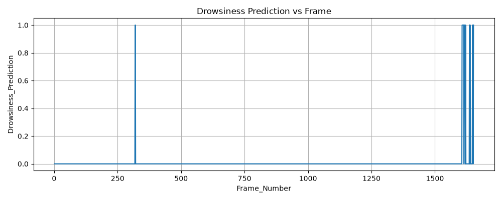

# S1 — Drowsiness

S1 estimates drowsiness cues from a camera stream. The primary integrated mode is part of the shared Python bridge and integrated Simulink model; this folder also contains a standalone 3-value demonstration model.

See the root [README](../../README.md) for environment setup, limitations, and the integrated workflow. See [ARCHITECTURE.md](../../ARCHITECTURE.md) for the relationship between these two modes.

## Standalone files

- `mediapipe_udp_sender.py` — webcam capture, face presence, EAR/MAR extraction, and UDP sender.
- `driver_monitor_sim_mediapipe.slx` — standalone Simulink receiver and drowsiness logic.
- `README.md` — this guide.

The sender loads the shared model `PROJECT/Models/external_backends/face_landmarker.task` and sends three little-endian doubles (face detected, EAR, MAR) to `127.0.0.1:5000` at 20 Hz.

## Run the standalone S1 demo

From the repository root:

```powershell
python -m pip install -r requirements.txt
python SECTIONS/S1_Drowsiness/mediapipe_udp_sender.py
```

In MATLAB, with the repository root as the current folder:

```matlab
addpath(genpath(pwd));
open_system('SECTIONS/S1_Drowsiness/driver_monitor_sim_mediapipe.slx');
set_param('driver_monitor_sim_mediapipe', 'SimulationCommand', 'start');
```

Start the Python sender before starting the model. Press `q` or Escape to stop the sender. For the integrated mode, use the root README commands instead of starting this sender.

## Example output

These figures show the type of feature/state trace produced in a prior demo run. They are illustrative, not current dataset metrics or safety validation.




## Interpretation and limits

The sender's overlay uses a candidate EAR threshold for an instantaneous eye-open/closed display. Temporal decisions belong to the Simulink logic. The thresholds have not been calibrated for individual drivers, camera placement, or representative road conditions. The latest saved batch snapshot has no detected faces or available S1 predictions; see [results status](../../results/README.md).
