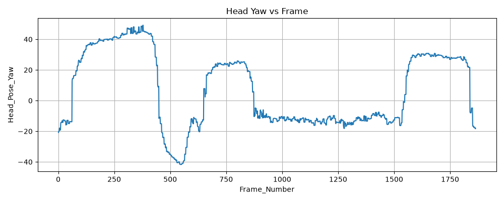
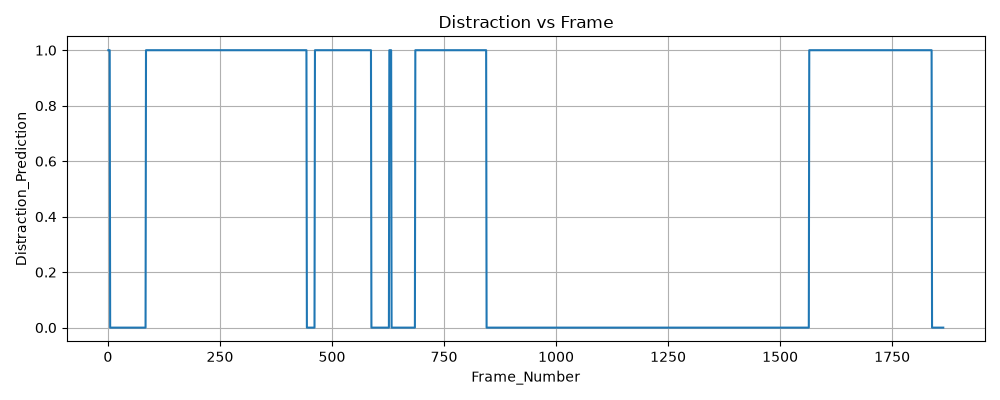

# S2 — Distraction and visual attention

The integrated system estimates head pose and gaze in the shared Python bridge and applies S2 logic in the integrated model. This folder contains the optional standalone hand-aware S2 demonstration, which has a distinct 14-value packet format.

See the root [README](../../README.md) for the integrated startup sequence and safety limitations. The full data-flow diagram is in [ARCHITECTURE.md](../../ARCHITECTURE.md).

## Standalone files

- `mediapipe_udp_sender.py` — webcam features and 14-value UDP sender.
- `driver_monitor_sim_distraction.slx` — standalone S2 model.
- `DistractionLogicSystem.m` — logic used by the standalone and integrated model.
- `SteeringWheelDashboard.m` — dashboard helper used by the standalone model.
- `hand_landmarker.task` — hand landmark model asset.

The sender also uses `PROJECT/Models/external_backends/face_landmarker.task`. It sends face presence, EAR/MAR, head pose, gaze, and hand/wrist cues as little-endian doubles to `127.0.0.1:5000`.

## Run the standalone S2 demo

From the repository root:

```powershell
python -m pip install -r requirements.txt
python SECTIONS/S2_Distraction/mediapipe_udp_sender.py
```

Then in MATLAB:

```matlab
addpath(genpath(pwd));
open_system('SECTIONS/S2_Distraction/driver_monitor_sim_distraction.slx');
set_param('driver_monitor_sim_distraction', 'SimulationCommand', 'start');
```

Start only one UDP sender at a time. Do not run standalone S2 alongside the integrated bridge or standalone S1 sender: all use port 5000 and the receiving models expect different packet lengths. Phone detection is not implemented.

## Example output

The figures below show representative S2 feature and state outputs.




